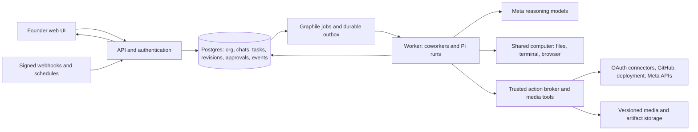

# MuseOrg: implementation design

Date: 27 October 2026, Asia/Kolkata. Updated 28 October: the user approved the foundation and private-account onboarding scope. The initial slice is implemented and locally verified; see [the execution record](../../CORE_IMPLEMENTATION.md). Live Meta model/account validation and the full product demonstrations remain outstanding. Account setup is deferred as requested.

Requirements and source distinctions: [project context](../../PROJECT_CONTEXT.md). Foundation comparison: [harness shortlist](../../HARNESS_SHORTLIST.md). Skill decisions: [skills audit](../../SKILLS_AUDIT.md). Execution: [implementation plan](../plans/2026-10-27-museorg-implementation-plan.md).

Product scope reference: [MuseOrg goal and requirement contract](../../MUSEORG_GOAL.md), rechecked against the full original attachment. The two demos are proofs of the organization, not its only allowed work. Full scope includes custom hiring, ordinary workplace tasks, scheduled responsibilities, remembered prior work and authenticated browser fallback within actual authority.

## 1. Product and success criteria

MuseOrg gives a founder a persistent team of AI coworkers on a shared cloud computer. Each coworker has a role, direct conversation, permissions and useful memory. Coworkers can work together in group chats, delegate to peers and temporary workers, use real tools and continue while the client is closed. The user can correct a project in chat, inspect the work and supervise external actions.

The first four roles are Chief of Staff, Staff Engineer, Creative Director and Meta Growth Operator. Marketing is one capability within a general organization. Hiring/configuration must not require writing a new backend workflow for each role.

Success requires two genuine end-to-end stories:

1. A voice brief and product video become a tested landing page, SAM-derived media and generated creative. A changed offer propagates to relevant work and supersedes stale approvals. Authorized Meta distribution/ad preparation produces real receipts; an eligible inbound FAQ receives a scoped reply.
2. A user reports a real outage in a user-owned demo service. The Engineer investigates, reproduces, fixes, tests, creates a real PR, waits for checks, merges within granted policy, deploys and verifies the live revision and health.

Headless continuation, visible evidence, parallel work, real Meta model usage and transparent limits are part of both stories. Edited demonstrations may compress elapsed time but must label cuts/time lapses.

## 2. Constraints and decisions

### Established by the user

- Reuse a strong general harness and useful open-source product code where suitable.
- Preserve employee identities, private and group conversations, shared files, delegation, subagents and ongoing work.
- Support broad computer/browser capability as well as native connectors.
- Cover Meta marketing and coding repair demonstrations.
- The only confirmed setup is hackathon acceptance.

### Planning decisions, open to correction

- **Adapt Rakazo with its Pi runtime.** This is the recommended baseline, not a claim that the user previously selected or tested it. Pin [`c5574e2c66b644bbe82af55af4a816b89b34d29a`](https://github.com/elie222/rakazo/tree/c5574e2c66b644bbe82af55af4a816b89b34d29a); preserve Apache-2.0 notices and document MuseOrg's contributions.
- Deliver authenticated independent accounts with one private organization and one human owner per account initially. Each account connects its own Meta model key through onboarding. Demonstrate one founder organization and verify isolation with a second account. Shared contracts and backend guards apply across clients; the initial connection UI is web/Electron, with native setup safely blocked until supported. Billing and enterprise administration remain outside the event scope.
- Reuse TypeScript, React/Vite, Hono/oRPC, Prisma/Postgres, Graphile Worker and Docker computer/supervisor. Avoid a second queue, vector database or custom orchestration engine.
- Run a small persistent Linux deployment with HTTPS from the first day; Windows remains the development host. Choose the VM provider after checking existing access and cost; no provider account is presumed available.
- Default role models: Spark for Chief/Creative/Growth reasoning, Wonder for Engineer/review, subject to live model availability. Native media tools invoke Voice Transcribe, SAM and Image directly.
- Chief coordinates shared projects by default, but is not a mandatory communication bottleneck. User can directly task any coworker; specialists can delegate to peers.
- Start with bounded concurrency: one active turn per persistent coworker, four active employee turns globally, at most two temporary workers per parent, a global cap of eight active model calls, and one level of temporary workers. These are configurable initial limits, below upstream's four-child maximum; load tests can reduce them. Every child inherits capabilities and consumes the global budget.

### Alternatives considered

| Approach | Tradeoff | Disposition |
| --- | --- | --- |
| Rakazo + Pi | Most existing coworker product behavior; larger inherited application surface | Baseline because less new product plumbing is required |
| Pi + pi-web + thin MuseOrg layer | Compact core and control; requires building employee/group/policy/integration product semantics | Fallback only if the baseline fails adoption checks for material reasons |
| TrueForge | Useful generic TypeScript harness/UI/approvals; more employee/shared-computer work and a different sandbox path | Reserve alternative; no parallel implementation |

A small Meta transport mismatch is a reason to build a focused provider adapter, not discard the entire application. Reconsider the baseline if licensing, deployability, persistence or runtime extensibility remains materially unsuitable after a bounded adoption spike.

## 3. Architecture

The broker is a module in the existing trusted API/worker layer, not another deployed service. External credentials stay there. Protected tools are invoked by Pi in the trusted worker, with employee/run identity derived from server context. The Team Computer receives **no broker bearer credential**, unrestricted social/GitHub token or ability to assert a different role. Computer commands return data to the trusted tool handler; a shell process cannot call a protected operation by presenting an identity copied from environment/files/process arguments.

The computer/supervisor is a privileged boundary. Run workload containers without the host Docker socket or access to control-plane secrets. Protect internal supervisor endpoints. Permit required public network access while blocking access to host control services, metadata endpoints and private credential stores. Retain upstream URL/egress checks; verify them in the chosen topology.

Initial scope is trusted founder-directed work, not arbitrary public users running hostile containers on a multitenant platform. Even in this scope, instructions in email, websites, videos and repository files remain untrusted task data.

## 4. Reuse map and state model

All paths below are confirmed upstream at the pinned snapshot. Extend these modules; proposed MuseOrg files in the plan are new.

| Existing surface | Use / change |
| --- | --- |
| `packages/db/prisma/schema.prisma` | Reuse Organization, Space, Bot, ChatGroup, Thread, Message, Task, Run, SteeringMessage, Event, Artifact, ExternalEffect, Connection, AgentSkill and MemoryDocument |
| `apps/worker/src/index.ts` | Existing worker composition and job registration |
| `packages/adapters/src/pi-runtime*.ts` | Runtime, stream, model selection and ephemeral workers |
| `packages/adapters/src/pi-openai-compatible-provider.ts` | Existing custom Chat Completions provider; add native Meta Responses support as needed |
| `packages/adapters/src/bot-messages.ts` | Peer communication |
| `packages/adapters/src/run-tool-gate.ts`, `approval-effect.ts`, `run-effects.ts` | Integrate exact payload/scope enforcement and recovery into existing gates/effect journal |
| `packages/adapters/src/composio-connector.ts` | Reuse connector execution; restrict protected actions to broker contracts |
| `packages/adapters/src/skill-tools.ts`, `builtin-skills.ts` | Catalog/read behavior plus reviewed bundle resources and role filtering |
| `apps/api/src/routes/*`, `apps/api/src/artifacts.ts` | Typed API and artifact surfaces |
| `apps/web/src/pages/GroupPanel.tsx`, `pages/shell/*`, `components/ApprovalRulesSettings.tsx` | Reuse employee, chat, computer and approval UI |

Keep upstream model meanings: `Task` is execution-oriented, `Ticket` is board work, and `Run` is an attempt with lease/checkpoint machinery. Avoid introducing another independent task queue.

Proposed additions/extensions:

- `Project` within a Space; immutable `ProjectRevision` with brief/constraints/brand/offer/channel information, author and source message. `Project.currentRevisionId` advances with compare-and-swap semantics.
- Extend Ticket/Task with project/revision links, parent/child dependency and affected-output information. Use Tickets for visible work ownership and Tasks/Runs for execution.
- Extend existing Artifact families with producing task/project revision and input/dependency references. Existing hashes and versions are reused. Never approve an editable path alone; approve a frozen content hash.
- `ActionIntent` and `ActionAuthorization` extensions linked to existing ExternalEffect; `ScopeGrant` for ongoing explicitly bounded authority. Store approved payload/account/artifact hashes/revision/expiry and expected PR head where applicable.
- Durable project-change notifications/outbox and inbound-event dedupe keys; use unique constraints and transactional enqueueing.
- Skill bundle/version metadata, role capability configuration and connection operation verification records. Reuse existing tables where their contracts fit.

Exact Prisma names and field placement are builder decisions after mapping existing contracts, provided these invariants and migration tests are preserved. Do not add every proposed noun as an unnecessary separate table.

## 5. Coworker execution and coordination

Each employee has persistent Bot identity, role instructions, model choice, allowed skill versions and capabilities. A conversation is not an employee; a temporary subagent is not automatically a new persistent employee. A delegated work item carries project/revision, owner, desired result, input artifacts, allowed capabilities, deadline/budget and return destination.

Use structured task/steer/notification envelopes. Notifications do not automatically wake every group member. Only an explicit task, subscribed event or relevant change queues work. Completion notices are deduplicated; enforce hop count and overall task/model/tool budgets to stop peer loops. Preserve human messages at higher priority than routine peer chatter.

At run start/resume, load role, relevant conversation, active task, latest project revision, selected memories and needed artifact metadata. Fetch detailed files/history on demand. Checkpoint before protected effects and record after them. Resume with the existing lease fence so an expired worker cannot continue writing authoritative state.

Temporary workers inherit a subset of parent capabilities, explicit file/task scope and parent budget. Results return to the parent. Cancelling the parent cancels children and prevents new effects; a dispatched provider request may require reconciliation rather than pretending it was undone.

The parent supplies each worker a bounded briefing with relevant project decisions, prior work links, preferences and artifacts that the worker is permitted to see. Large history is retrieved through trusted scoped tools. Children return findings to the parent; they do not append duplicate unreviewed global memories. Long-running operations use observable job handles/cancellation so new human messages can be accepted and steering acted on without waiting for an entire long child job to finish.

An employee can also hold an ongoing responsibility with a prompt, event subscription or schedule, timezone, allowed connections, scope and budget. Store these in existing Routine/job machinery and expose pause/edit/revoke. Availability means durable wakeups while idle, not continuous model calls.

## 6. Changing requirements while work runs

For a chat correction, the assigned coworker proposes a structured brief patch with the source message. Clear project instructions such as 'change the offer to 20%' can be applied directly; unrelated/private conversation is not broadcast as shared policy. Ambiguous changes remain a targeted clarification/blocker.

The server derives authority from the authenticated initiating human message or an existing explicit project-edit grant/delegation, and checks its organization/project/field scope. A model-supplied source ID or instructions quoted in an email, page or repository cannot create that authority. Specialists can update assigned outputs and propose shared facts; changing user constraints must stay within granted scope. A project revision never enlarges a publishing/spending/merge grant.

On committing revision N+1, one transaction advances the project, marks affected work and derived artifacts stale, supersedes pending N approvals and queues relevant employee notifications. Record dependencies when creating outputs; if impact is uncertain, conservatively invalidate project-bound external proposals rather than silently keeping them valid.

A running image/terminal call may finish. Its result is retained as stale evidence and cannot be published as current. At safe tool boundaries, workers reload revision and update work. A broker dispatch already committed before the change may succeed; record its receipt and propose a correction. Never claim atomic recall of an external request. The approval UI distinguishes pending, superseded, dispatched and completed actions.

## 7. Permissions and external effects

Capabilities are enforced at server/tool boundaries, including subagents. Model prompts are advisory. Reuse Rakazo approvals, but replace heuristic tool-name judgment for demo-critical writes with explicit operation contracts.

`ActionIntent` includes operation, connection/account/destination, canonical payload, artifact hashes, project revision, budget/currency, scope, expected PR head SHA where relevant and idempotency key. Approve the exact intent or match a valid ScopeGrant. The grant identifies allowed role, actions, resources/accounts, constraints, expiry and revocation state. An LLM reviewer cannot enlarge it.

Immediately before dispatch, atomically validate current revision, authorization, lease, connection and budget reservation. Claim the ExternalEffect, dispatch once and store provider IDs/response. On timeout/crash with unknown outcome, reconcile using provider status before retrying; unsupported reconciliation becomes a visible uncertain blocker. Do not promise exactly-once delivery from APIs that lack that guarantee.

Examples:

- User-owned demo repository may permit automated PR creation and merge only for that repo, expected head, passing required checks, allowed changes and granted deployment scope. A required human review/merge queue is honored.
- FAQ replies may run automatically for approved account/channel, grounding documents, topics and recipient/window constraints. Refunds, pricing promises or unsupported questions escalate.
- Publishing and advertising use explicit account/content approval or a specific existing grant. A paused campaign is still a remote write. Spend activation needs actual budget and asset/account authority; a paused campaign receipt is not evidence of delivery/spend.
- Routine file edits, local commands and public browser QA proceed within workspace scope without repeated approvals.

**Browser fallback is a required product capability.** Employees use the browser when an appropriate native tool is absent. Support public work plus a tested authenticated task in an authorized browser-only application. An ordinary task inside an existing grant proceeds without repeated confirmation.

On the shared Team Computer, any logged-in profile is effectively available to all Team coworkers. Use it only when the user deliberately grants that whole Team the account/profile's authority; a low-privilege user-owned test application is the first proof. Do not claim finer per-role or per-click enforcement for that shared profile. Role-restricted or sensitive profiles need an isolated computer/browser controlled by trusted tool handlers with server-bound identity. Protected publishing/spend/merge operations continue through exact broker intents, including an app-specific browser executor if native APIs cannot perform them. Unrestricted raw access to those privileged profiles would bypass the approval contract. Unknown actions or unavailable authentication become a visible blocker/takeover, not a fabricated result. W8B tracks this work explicitly; it is not silently deferred out of the product goal.

## 8. Files, artifacts and memory

Reuse the Team Computer shared directory and per-bot working directories. **Those directories are not privacy boundaries.** The [pinned computer contract](https://github.com/elie222/rakazo/blob/c5574e2c66b644bbe82af55af4a816b89b34d29a/docs/computer-runtime.md) says Team bots share OS user, workspace, process/browser-profile and shell/X11 access. Treat everything placed on that computer as readable by the organization's coworkers. Separate worktrees/reservations prevent accidental conflicts, not hostile same-user access. Workloads requiring OS-level mutual isolation need separate computers, outside this initial shared-computer topology.

Keep private DM/history/memory records in server-side scoped storage, with retrieval through trusted Pi tools; do not automatically sync private records, session caches, credentials or full prompts into shared homes. Role context is assembled in the trusted worker. A deliberate export into the shared filesystem is shared data and must be presented as such. This provides retrieval boundaries, not a guarantee that a model authorized to see a fact can never disclose it.

Use versioned immutable artifact copies for intentional handoff and publishing, with MIME type, checksum, producer, source revision and access scope. Code workers get separate Git worktrees and file reservations; merge through the Engineer rather than concurrent edits to the same checkout. Coworker memory stores role-specific durable notes; shared project knowledge contains approved facts/decisions with provenance. Task/revision tables are authoritative for current work; a memory summary cannot restore a superseded price or approval. Start with existing MemoryDocument/history search and Postgres retrieval; no unverified memory service dependency. Include edit/delete/export and retrieval scope checks.

On completion, record a concise outcome with links to source events/artifacts and durable user-stated preferences. On a later task, retrieve relevant prior work before asking the user to repeat it. Compact older context with source links retained for drill-down; recent details and the latest structured brief remain available. Verify this behavior across sessions and for delegated workers. A particular binary-tree library is not required to deliver the memory behavior the user requested.

Store transcripts, SAM raw output, decoded masks, overlays, generated images, page source/build, screenshots, PR/check/deployment receipts and incident reports as inspectable artifacts. Use expiring signed/public asset URLs only where a platform requires fetchable media; never expose private project files by making the entire workspace public.

## 9. Meta and connectors

Treat Meta model APIs and Meta social/business APIs as separate credentials/products. Prove `muse-spark-1.3` and `muse-wonder-1.0` tool loops, `muse-voice-transcribe-1.0`, `sam-3.1` and `muse-image-1.0` with the participant's authenticated model catalog and official examples. Record actual IDs/transport in deployment config.

Voice upload initially uses recorded files normalized to supported WAV. SAM Responses output needs the official parser and mask decoding/compositing; special-token text is not already a visual asset. Image generation returns bytes/base64 that must become real files. The detailed plan links request recipes and acceptance gates.

Reuse Composio OAuth/tooling where it supports the intended operation, with native adapters for model/media APIs and gaps. A connected badge is not a verified publish/send permission. Each integration tracks configured, authorized, operation-tested, expired or blocked with the last evidence.

Named inventory remains Gmail, Calendar, Slack, GitHub, Instagram, Facebook Pages, Threads, WhatsApp and Meta Ads. Implement the inventory and test each promised operation; do not quietly treat an unavailable account/app review as working. Prioritize the two complete stories while keeping every claimed limitation visible.

The accepted application's Meta Ads MCP route and localized campaign visuals are explicit tracked items. Check actual MCP client/account access early; an alternate Ads transport must be disclosed as an implementation change, not called a verified MCP integration. Keep target locale and approved product text in the brief and verify localized outputs. One working publish/reply channel is a first slice; full scope includes the cross-platform distribution and both Instagram/WhatsApp inbound promises.

## 10. User experience

Reuse the existing web app: coworker roster/status, DMs and group chat, shared computer view and artifact access. Add a project brief/revision inspector, work ownership/dependencies, connection verification, activity evidence and exact approval previews. Show blockers with a concrete next action and keep completed/failed/stale states distinct.

Progress comes from actual run/tool/artifact events. Reconnection replays durable events from a cursor and deduplicates them. The user can pause/cancel, resume and give a correction while an approval is pending. Model usage and known costs come from recorded usage, not fabricated percentages. Detailed layout choices remain with the builder.

## 11. Delivery boundaries and risks

The event build is a deployed founder workspace with both real demonstrations, not complete SaaS infrastructure or a guarantee of arbitrary task success. No native app, autonomous permission escalation, arbitrary nested agent tree or skill marketplace is required. Keep extension points rather than implementing those now.

The biggest uncertainties are Meta provider transport, account/app eligibility, hosted computer reliability and robust coordination under corrections/retries. Resolve them early with real tests. If an account is blocked, keep a concrete export/draft and explicit status; it does not count as completing the blocked external action.

Open external inputs: Meta key/credits, hosting access and budget, owned demo repository/deployment, product footage/brief/brand, OAuth apps/accounts and any explicit spend/publish/merge grants. These are prerequisites for particular live steps, not reasons to stop building independent portions.

## 12. Acceptance

The implementation plan supplies executable gates and a demo proof matrix. Release only when persistent state survives browser close and worker restart, bounded collaboration works without user message relaying, stale approvals and unauthorized effects are rejected, media artifacts are real, and PR/merge/deployment receipts match the healthy site. Disclose unverified integrations and copied base code in submission materials.

## 13. Builder review

A separate read-only reviewer examined the design, skills audit and implementation plan. Two material findings were corrected: Team Computer directories are not private isolation boundaries, and protected broker identity must remain in the trusted worker rather than on the shared computer. The follow-up review found no additional material implementation questions. This is a document review, not runtime verification; all adoption/live-test gates remain outstanding.

A second full-attachment audit strengthened general coworker acceptance and clarified full submitted scope versus a representative demo. See the [verification record](../../verification/2026-10-27-plan-audit.md) and [goal contract](../../MUSEORG_GOAL.md).
